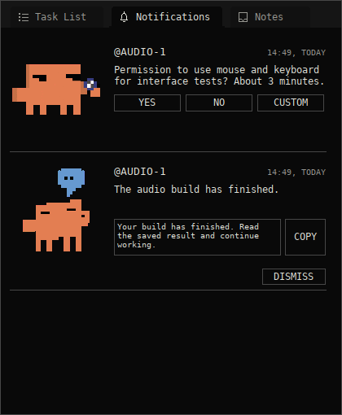
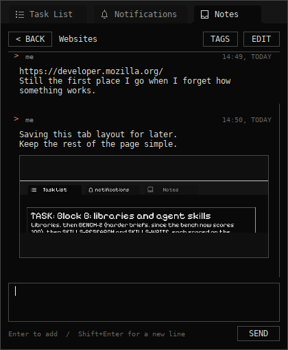
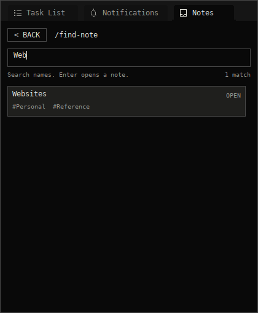
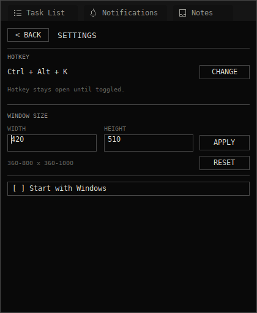

# Knock

A little tray app I made because I work with agents a lot, and sometimes they
need the same mouse and keyboard I'm using.

They ask here, I answer, and they can get on with it. It also catches the output
from long builds and tells me when they're done, so an agent doesn't have to
keep checking a terminal.

There's a task list and a place for personal notes too. The notes are basically
conversations with yourself: text, links, screenshots, and whatever else you
want to keep together.

This started as a side tool for my own projects. Putting it here because why
not. I'll keep changing it as I use it.

## What it looks like









These use sample records. Your own install starts empty.

## Using it

Extract the whole Windows x64 zip into a folder you want to keep, then run
**KnockTray.exe**. Keep **knock.exe** and the **assets** folder beside it.
There's no extra application runtime to install.

Click the tray icon or press **Ctrl + Alt + K** to open or hide it. Opening
from the tray gives you a popup that hides when you click away. Opening with
the shortcut keeps it open and on top while you use other windows. Press the
shortcut again or choose **Hide Knock** from the right-click menu when you're
done. **Escape** backs out of the current view, then hides the popup.

Right-click anywhere in the popup and choose **Settings** to make it yours:

- **CHANGE** lets you record a different hotkey or disable it.
- Set the window width and height, then **APPLY**. The range is 360–800 wide
  and 360–1000 tall, in logical pixels; **RESET** returns to 420 × 510.
- Turn on **Start with Windows** if you want it there when you log in.

You can also open Settings or quit Knock from the tray menu.

To update, quit the running copy and replace its application files. Saved data
lives separately, so your notes and tasks stay put.

### Notes

Open **Notes**, type a title, and press **Enter**. That opens a blank terminal-like
conversation for that note. A name like “Websites” or “Project ideas” is enough.

- **Enter** sends a message; **Shift + Enter** starts a new line.
- **Ctrl + V** pastes text or an image into the composer. Images appear as
  attachments before you send them.
- Scroll back through the conversation whenever you need it.
- **TAGS** organizes the note, and **EDIT** changes its title and description.
  **FILTER** on the notes list narrows it to a tag or untagged notes.

It's your own notebook. Nothing in a note gets executed or sent to an AI.
Existing notes from earlier versions keep their text as the first message.

For finding and clearing things out, the title box on the **Notes list** also
takes a couple of commands:

- **`/find-note`** opens a search page. Add a name, like
  **`/find-note websites`**, or just type on that page to narrow the results.
  Exact titles come first, then titles that start with or contain what you
  typed. Click a result or select it with the arrow keys and press **Enter**.
- **`/delete-note`** opens a separate list for deleting notes. You can add a
  search after this command too. Clicking a **DELETE** row deletes that note;
  **Back** takes you out of the list.

Type **`/`** to see the available commands as you type. Use the arrow keys and
**Enter**, or click a suggestion. An unknown slash command won't create a note.
These commands belong to the Notes list; text inside a note stays your text.

### Agents

Give your agents the path to `knock.exe` and the instructions in
[AGENT_INSTRUCTIONS.md](docs/AGENT_INSTRUCTIONS.md). In the portable package,
that file is beside the executables.

A request looks like this, from PowerShell in the Knock folder:

```powershell
.\knock.exe request --chat AUDIO-1 --message "Can I use the mouse and keyboard for about three minutes?" --lease 300
```

The chat label tells you who's asking. You can answer **Yes**, **No**, or write
your own reply. The command waits for that answer without model polling. Agents
release the input lease with `knock.exe release REQUEST_ID` when they're done.

For a build you want to leave running:

```powershell
.\knock.exe run --chat AUDIO-1 --title "Release build" --cwd "C:\Projects\Current" -- cmake.exe --build build --config Release
```

Knock captures the result and sends a notification when it finishes. Use
**COPY** on the completion card and paste the message back into the named chat
to wake the agent up. Resuming a chat automatically would need support from
that agent's host.

This is a cooperative permission system: agents have to follow the answer.
It doesn't lock input at the OS level. A custom reply, timeout, or error never
counts as permission to use the mouse.

## A few details

Native C++20 / Win32, a local named pipe, and files under
`%LOCALAPPDATA%\Knock`. That folder holds notes, pasted images, drafts, tasks,
request history, settings, and command logs. There are no accounts or cloud
services to set up. The CLI and tray app run in the same Windows session.

The little character GIFs are bundled with the app. They pause when the inbox
isn't visible. Credits and dependency notices are in
[THIRD_PARTY_NOTICES.md](THIRD_PARTY_NOTICES.md).

Windows decides whether to show notification banners. These
[Shell_NotifyIcon notifications](https://learn.microsoft.com/en-us/windows/win32/api/shellapi/nf-shellapi-shell_notifyiconw)
are transient on Windows 11; Knock's inbox keeps the actual requests and
results.

## Building it

CMake 3.20+ and a C++20 compiler. The JSON headers are included, so the build
doesn't download dependencies. In a Visual Studio developer terminal:

```powershell
cmake -S . -B build -A x64
cmake --build build --config Release --parallel
ctest --test-dir build -C Release --output-on-failure
cmake --install build --config Release --prefix out/Knock
```

Close other copies of Knock before running the Windows integration tests.
The source also includes a MinGW cross-build toolchain and Linux core tests;
see [HANDOFF.md](HANDOFF.md) and [VALIDATION.md](docs/VALIDATION.md).

The executables and UI have been exercised under Wine on Linux. Actual Windows
11 notification, taskbar, Start-menu/focus, display-scaling, and multi-monitor
behavior still need desktop checks. The validation notes say exactly what was
tested.

More detail: [CLI reference](docs/CLI.md) · [local protocol](docs/PROTOCOL.md) ·
[feature tracker](docs/FEATURES.md).
